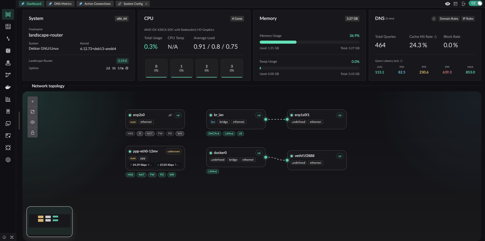
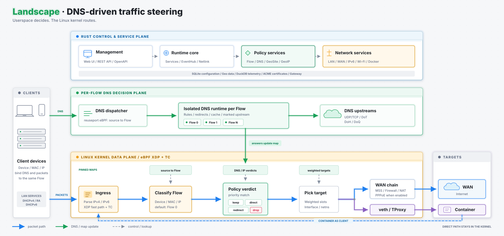

<div align="center">

[](https://www.gnu.org/licenses/gpl-3.0)  

**Landscape 依網域名稱導向流量，而不只是依 IP。每個 flow 都有自己獨立的 DNS 伺服器。**

**DNS 回應會填入核心的 eBPF map，封包在 XDP/TC 層被導向。**

**沒有使用者空間的資料路徑，也沒有 iptables。**

> 以 Rust / eBPF 開發。

</div>

[简体中文](./README.zh.md) | [繁體中文](./README.zh-Hant.md) | [English](./README.md) | [使用說明](https://landscape.whileaway.dev/)

## 螢幕截圖


## 架構

<picture>
  <source media="(prefers-color-scheme: dark)" srcset="./assets/arch-dark.svg">
  <source media="(prefers-color-scheme: light)" srcset="./assets/arch-light.svg">
  
</picture>

Landscape 將流量導向分為兩個平面：

**DNS 平面（使用者空間）。** flow 是一組原則群組，裝置可依 IP 或 MAC 加入。每個 flow 都有自己獨立的 Hickory DNS 伺服器，擁有各自的快取、上游（UDP/DoH/DoT/DoQ）和規則。DNS 回應會填入核心中各個 flow 專屬的 eBPF map。

**資料平面（核心）。** XDP 和 TC 掛鉤讀取這些 map，以線路速度導向封包。符合某個 flow 的封包會依其原則導向，其餘封包則直接通過，不需要切換到使用者空間。

DNS 結果 → eBPF flow map → 核心內 TC/XDP 導向 → 介面路由

DNS 平面負責決策，核心負責執行。

## 核心功能
* 透過 eBPF 由 DNS 驅動的流量導向：DNS 回應會填入各個 flow 專屬的核心 map
* 細緻的 NAT：預設採用比對稱式更嚴格的 NAT 原則，並可針對個別網域／IP 設定完全錐型（full-cone）NAT 例外（[詳情](https://landscape.whileaway.dev/features/nat.html)）
* 每個 flow 獨立的 DNS：各自擁有獨立的快取和上游，不會跨 flow 洩漏
* 將符合 flow 的封包重新導向到 Docker 容器，可搭配任何相容 TProxy 的程式擴充
* 地理資料庫管理：支援 DAT 和 TXT 格式
* 完整的 REST API：UI 中的所有操作都能用腳本執行

## 為什麼選擇 Landscape

**標準 Linux，不被綁定。** Debian、Arch、openSUSE，你的發行版，你說了算。

**放心升級。** 單一目錄，換上新的執行檔，設定會自動遷移，也可以降版。

**適合你區域網路的 NAT。** 需要時為 BT/PT 提供完全錐型 NAT，其餘情況一律使用嚴格 NAT，以網域／IP 為單位控制，沒有一體適用的規則。

**一次故障，只影響一處。** 每個 flow 各自擁有 DNS 和流量原則。某個容器掛了？只有經過它的流量受影響。

## 使用 lkit 安裝

[Landscape Kit](https://github.com/landscape-router/landscape-kit) 提供 `lkit` 主控台與命令列工具，用於安裝和管理 Landscape，包括首次部署、更新、版本切換、備份／還原、修復和網路接管。

```bash
curl --proto '=https' --tlsv1.2 -fsSL https://github.com/landscape-router/landscape-kit/releases/latest/download/install.sh | sudo sh
# Or:
wget -qO- https://github.com/landscape-router/landscape-kit/releases/latest/download/install.sh | sudo sh
```

接著啟動主控台：

```bash
sudo lkit
```

`sudo lkit` 會開啟互動式主控台。若要自動化，請使用明確的子命令，例如 `sudo lkit --non-interactive install --password-file /root/lkit-password`。發行的執行檔支援以 glibc 為基礎的 Linux（`x86_64` 和 `aarch64`），不支援 Alpine 等使用 musl 的發行版。

如果你偏好手動安裝，下方的手動步驟仍然可用。

## 快速開始

### 先決條件

- Linux 核心 ≥ 6.12，並啟用 BTF/BPF，需要 `root` 權限；不支援非 Linux 核心（FreeBSD、macOS）
- Docker（選用，用於容器重新導向）

### 1. 建立設定目錄

```bash
mkdir -p /root/.landscape-router
```

### 2. 下載發行檔案

- 從 [Releases](https://github.com/ThisSeanZhang/landscape/releases) 下載（後端執行檔與前端靜態資源分開發行）
  - 下載 `static.zip`
  - 下載適用於你的架構的 `landscape-webserver` 執行檔
- 解壓縮到 `/root/.landscape-router/static`（這是預設路徑，也可以自訂）

### 3. 啟動 Landscape

以 `root` 身分執行：

```bash
./landscape-webserver
```

預設值：設定位於 `/root/.landscape-router`，HTTPS 使用連接埠 `6443`，帳號／密碼為 `root` / `root`。

Landscape 不需要預先建立任何設定檔就能直接啟動。如果你想透過 `landscape_init.toml` 進行初始化，請參閱使用說明網站上的設定指南。

你可以用 `./landscape-webserver --help` 查看更多選項。

### 4. 開啟管理介面

- `http://landscape.local:6300` 會自動重新導向到 HTTPS
- `https://landscape.local:6443` 會開啟 Web UI
- `https://landscape.local:6443/api/docs` 會開啟 REST API 說明頁面

## 以 systemd 服務執行

確認服務運作正常後，你可以將它設定為 `systemd` 服務：

```ini
[Unit]
Description=Landscape Router

[Service]
ExecStart=/root/landscape-webserver
Restart=always
User=root
LimitMEMLOCK=infinity

[Install]
WantedBy=multi-user.target
```

請將 `ExecStart` 換成你的執行檔實際路徑。

## 開發

建置指南：[BUILD.md](./BUILD.md) | [BUILD.zh.md](./BUILD.zh.md)

## 授權條款

- `landscape-ebpf`：[GNU General Public License v2.0](https://www.gnu.org/licenses/old-licenses/gpl-2.0.html)
- 其他部分：[GNU General Public License v3.0](https://www.gnu.org/licenses/gpl-3.0.html)

如果你有建議或遇到問題，歡迎開啟 [issue](https://github.com/ThisSeanZhang/landscape/issues)。
